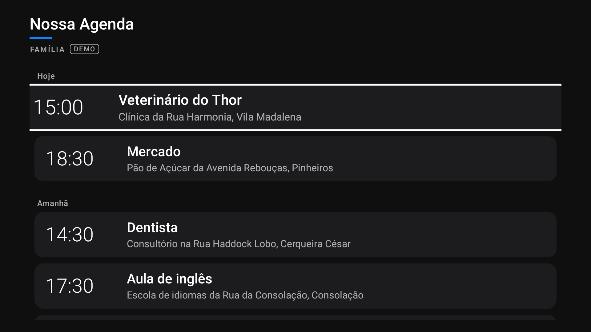
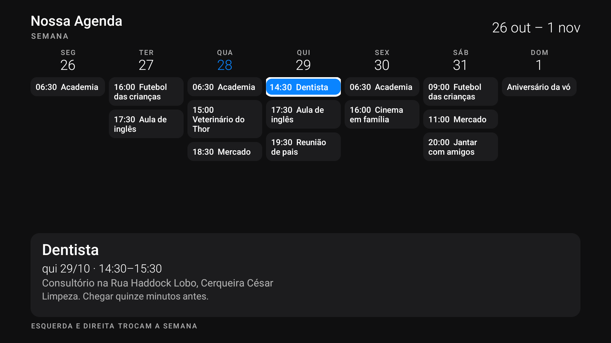

<p align="center"></p>

# 📅 Nossa Agenda

**A agenda da família na tela da TV.** Um app nativo para Fire TV / Android TV que mostra os compromissos de uma agenda do Google Agenda, pensado para ser lido do sofá e navegado só com o controle remoto.

> Este repositório é a versão de demonstração: os compromissos são fictícios e vêm de `assets/demo.ics`.

## ✨ O que faz
- **Próximos compromissos** agrupados em *Hoje*, *Amanhã*, `qui 30/10`..., com hora, título e local.
- **Visão da semana** em 7 colunas. O compromisso clicado fica em destaque e o detalhe aparece embaixo (horário, local e descrição). Esquerda e direita trocam de semana.
- **Sincronização** pelo endereço secreto iCal do Google Agenda, sem login na TV. Atualiza ao abrir e a cada 15 minutos, e o cache abre mesmo sem internet.
- **Parser ICS próprio**: fusos horários, eventos de dia inteiro, repetições (`DAILY`, `WEEKLY`, `MONTHLY`, `YEARLY`) e ocorrências reagendadas.



## 🎨 Design
Visual escuro inspirado na Apple: fundo `#0F0F10`, cartões `#1C1C1E` com cantos de 14 dp e destaque azul `#0A84FF`. O foco do D-pad aumenta o cartão e dá a ele uma borda branca.

## 🛠️ Técnica
- Java + Android SDK, `minSdk 25` (roda no Fire OS 6 / Fire TV Stick 4K de 2018), sem bibliotecas externas.
- Testes de parser em JVM puro (`./gradlew test`).

## 🚀 Usar com a sua agenda
1. No Google Agenda, abra **Configurações › sua agenda › Integrar agenda** e copie o **Endereço secreto no formato iCal**.
2. Crie `secrets.properties` (já está no `.gitignore`) com:
   ```properties
   ICAL_URL=https://calendar.google.com/calendar/ical/.../basic.ics
   ```
3. Compile e instale:
   ```sh
   ./gradlew assembleDebug
   adb install app/build/outputs/apk/debug/app-debug.apk
   ```
Sem `secrets.properties`, o app abre no modo **DEMO**.

---
Feito com ❤️ para a família.
